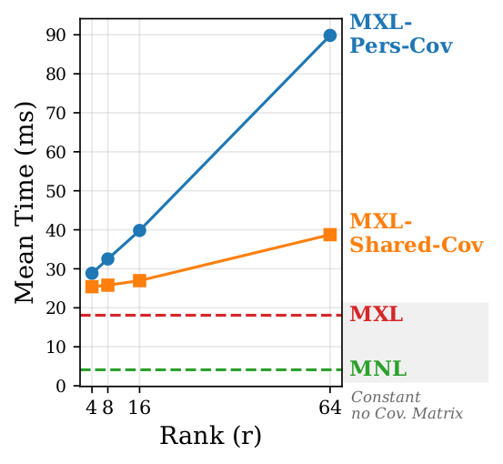
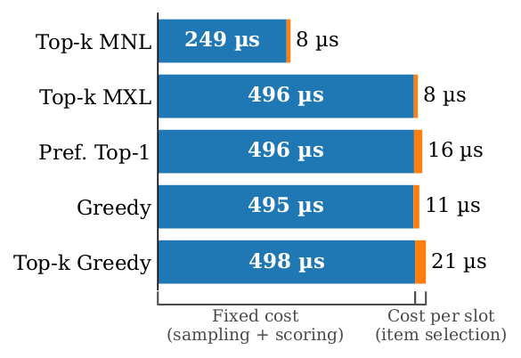
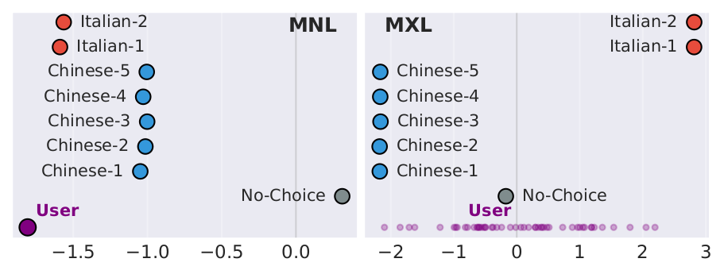
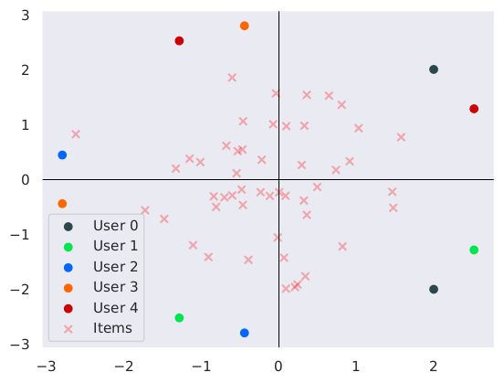
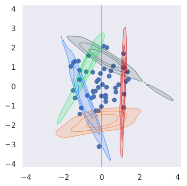
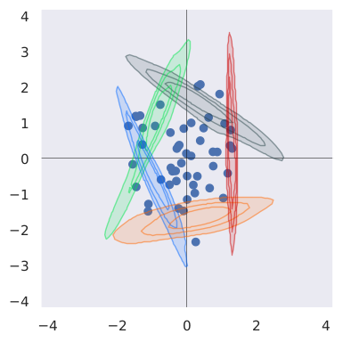

# Unified Slate and Top-k User Modeling Under the Mixed Multinomial Logit Model

Source code for the paper

> **Unified Slate and Top-k User Modeling Under the Mixed Multinomial Logit Model**<br>
> Thorsten Krause and Harrie Oosterhuis<br>
> SIGIR-AP 2026, December 13–15, 2026, Singapore. https://doi.org/10.1145/3848000.3850177

If you use this code, please cite the paper (see [Citation](#citation)).

The code was cleaned up for publication after the experiments had been run. If something does not work as described, please open an issue or contact the authors.

**The DHRD results of this repository differ from the ones in the paper.** After the paper was finalized, we corrected two issues in the DHRD experiments and re-ran them; see [Corrected DHRD Results](#corrected-dhrd-results). The ContentWise and the semi-synthetic results are not affected and our method's advantage over the baselines is clearer than before.

## Models and Datasets

All models are trained and evaluated through `src/pipelines/run_experiment.py`. The names in the code differ from the names in the paper:

| Paper | Code (`--model_name`) |
|---|---|
| Random | `Random` |
| MostPop | `MostPop` |
| Intercept | `Intercept` |
| MNL | `MNL` |
| MNL-Multi | `MNL_Max` |
| Disc. MXL | `MNL_Multi` |
| Diag. MXL | `MXL` |
| Pers-Cov-MXL | `MXL_Corr` |
| Shared-Cov-MXL | `MXL_Corr_Shared` |

Note the two crossed names: the paper's MNL-Multi is `MNL_Max` in the code, and the paper's Disc. MXL is `MNL_Multi`. 

| Dataset in the paper | Code (`--dataset_name`) | Reference |
|---|---|---|
| ContentWise | `ContentWise_LastActionSplit` | Fernando B. Pérez Maurera, Maurizio Ferrari Dacrema, Lorenzo Saule, Mario Scriminaci, and Paolo Cremonesi. 2020. ContentWise Impressions: An Industrial Dataset with Impressions Included. In *Proceedings of the 29th ACM International Conference on Information & Knowledge Management (CIKM '20)*. ACM, New York, NY, USA, 3093–3100. https://doi.org/10.1145/3340531.3412774 |
| DHRD | `Stockholm_LastActionSplit` | Yernat Assylbekov, Raghav Bali, Luke Bovard, and Christian Klaue. 2023. Delivery Hero Recommendation Dataset: A Novel Dataset for Benchmarking Recommendation Algorithms. In *Proceedings of the 17th ACM Conference on Recommender Systems (RecSys '23)*. ACM, New York, NY, USA, 1042–1044. https://doi.org/10.1145/3604915.3610242 |
| Semi-synthetic, source MNL or Diag. MXL (explicit user embeddings or SASRec) | `ContentWise_LastActionSplit_synthetic_<source run>_...`, generated from models trained on ContentWise, see [Semi-Synthetic Evaluation](#semi-synthetic-evaluation) | |

| Slate type in the paper | Policy in the code |
|---|---|
| Top-k | `top_k` |
| Pref. Top-1 | `diverse_embeddings` |
| Greedy | `greedy` |
| Top-k-Greedy | `top_k_greedy` |

## Setup

### Install packages

Install the required packages via
```bash
pip install -r requirements.txt
```
`requirements.txt` targets Python 3.11 on Linux and pins the CUDA 12.4 build of PyTorch 2.6.

The compute benchmarks in the paper were run on single NVIDIA RTX 3090 GPUs.

### Download datasets

This repository uses the following datasets:
- ContentWise from https://contentwise.github.io/contentwise-impressions/
- DHRD from https://github.com/deliveryhero/dh-reco-dataset (referred to as "Stockholm" in the code)

The papers that introduced the two datasets are listed in the dataset table under [Models and Datasets](#models-and-datasets).

Download both datasets from the pages above and place them as follows:
- ContentWise: the CW10M CSV files `interactions.csv.gz` and `impressions-direct-link.csv.gz` in `data/ContentWiseImpressions/ContentWiseImpressions/data/ContentWiseImpressions/CW10M-CSV/`, i.e. the repository cloned into `data/ContentWiseImpressions/` with the dataset downloaded as described there.
- DHRD: the Stockholm archive (`data_se.zip`) extracted to `data/DHRD/data_se/`, so that `data/DHRD/data_se/orders_se.txt` and `data/DHRD/data_se/vendors_se.txt` exist.

Then run the pre-processing notebooks `8_content_wise_impression_data.ipynb` and `15_stockholm_data_preprocessing.ipynb`. They write the pre-processed `.npz` files next to the raw data.

Run the DHRD notebook with the environment variable `PYTHONHASHSEED=0` to obtain the data file behind the reported results: the order in which the notebook lists the restaurants available to a customer depends on Python's string hashing.

## Running Experiments

Every training and evaluation run is one line of a generated command file. The lines are independent of each other, so the command files can simply be executed line by line:

```bash
bash data/hyperparameter_grids/<DatasetName>/commands_MXL.txt
```

The steps below are the same for both datasets; replace `<DatasetName>` with `ContentWise_LastActionSplit` or `Stockholm_LastActionSplit`.

### 1. Generate Hyperparameter Grid Commands

Set `dataset_name` in `11_generate_hyperparam_grids.ipynb` and run the notebook. It reads the grid `data/hyperparameter_grids/<DatasetName>.yaml` and writes one command file per model to `data/hyperparameter_grids/<DatasetName>/`.

A model can have several blocks in a grid file. The DHRD grid lists a base block per model and, where the best configuration lay on the edge of that block, follow-up blocks named `<Model>_followup_<n>`.

### 2. Run Hyperparameter Optimization

Run the command files in `data/hyperparameter_grids/<DatasetName>/`.

### 3. Analyze Hyperparameter Results and Generate Evaluation Commands

Set `DATASET_NAME` in `12_evaluate_hyperparameter_optimization_results.ipynb` and run the notebook. It:
- analyzes the hyperparameter optimization results in `data/hyperparameter_optimization_results/<DatasetName>/`,
- identifies the best hyperparameters for each model,
- writes the evaluation command files to `data/evaluation_commands/<DatasetName>/` (including MostPop and Random, derived from the Intercept commands).

### 4. Run Final Evaluation

Run the command files in `data/evaluation_commands/<DatasetName>/`.

## Corrected DHRD Results

The DHRD results in the paper were produced with two issues that this repository corrects:

| | Paper | This repository |
|---|---|---|
| Order of each customer's orders in the pre-processed data | by order id, which does not follow time | by order time |
| Padding of the order history (SASRec backbone) | the pre-processed data pads histories with index -1, but the models assumed padding index 0 | the models take the padding index from the dataset |
| Hyperparameters | tuned on the setup above | tuned again on the corrected setup |

The first issue changes which order of a customer is the validation and the test order, so it affects all models; the second affects only the models with a SASRec backbone. ContentWise and the semi-synthetic datasets have neither issue, and their results are unchanged.

### Results

Mean over 100 training seeds; lower NLL and higher nDCG are better. As in the paper, **bold** marks the best and <ins>underline</ins> the second-best value per column within each block, and <sup>*</sup> / <sup>†</sup> mark models that are significantly better than the MNL model of the same block at p < 0.01 / p < 0.05 (one-sided paired bootstrap over training seeds). The test sets of the two setups differ due to the change in how actions are ordered, so the columns "paper" and "corrected" cannot be compared directly.

| Model | NLL paper | NLL corrected | │ | nDCG paper | nDCG corrected |
|---|---|---|---|---|---|
| **Explicit user embeddings** | | | │ | | |
| Random | – | – | │ | 0.1835 | 0.1791 |
| MostPop | – | – | │ | 0.1986 | 0.2328 |
| Intercept | 5.3373 | 5.1150 | │ | 0.2016 | 0.2426 |
| MNL | 5.1242 | 3.1498 | │ | **0.3551** | 0.5676 |
| MNL-Multi | 5.0381<sup>*</sup> | 3.1795 | │ | 0.3476 | 0.5675 |
| Disc. MXL | <ins>5.0036</ins><sup>*</sup> | 3.1533 | │ | 0.3484 | 0.5686<sup>*</sup> |
| Diag. MXL | 5.0212<sup>*</sup> | **3.1121**<sup>*</sup> | │ | 0.3499 | <ins>0.5708</ins><sup>*</sup> |
| Pers-Cov-MXL | **4.9203**<sup>*</sup> | 3.1167<sup>*</sup> | │ | 0.3461 | **0.5713**<sup>*</sup> |
| Shared-Cov-MXL | 5.0189<sup>*</sup> | <ins>3.1124</ins><sup>*</sup> | │ | <ins>0.3500</ins> | <ins>0.5708</ins><sup>*</sup> |
| **SASRec backbone** | | | │ | | |
| MNL | 3.6830 | 3.3335 | │ | 0.5911 | 0.5482 |
| MNL-Multi | 3.7096 | 3.3700 | │ | 0.5690 | 0.5430 |
| Disc. MXL | <ins>3.4612</ins><sup>*</sup> | 3.3684 | │ | <ins>0.5948</ins><sup>*</sup> | 0.5404 |
| Diag. MXL | 3.4927<sup>*</sup> | 3.2871<sup>*</sup> | │ | 0.5913 | <ins>0.5530</ins><sup>*</sup> |
| Pers-Cov-MXL | **3.4327**<sup>*</sup> | <ins>3.2860</ins><sup>*</sup> | │ | 0.5940<sup>*</sup> | 0.5515<sup>*</sup> |
| Shared-Cov-MXL | 3.5203<sup>*</sup> | **3.2834**<sup>*</sup> | │ | **0.5952**<sup>*</sup> | **0.5556**<sup>*</sup> |

What changes w.r.t. research questions:

- **The Gaussian MXL models are now consistently significantly better than MNL on both metrics.** This observation strengthens the paper's conclusions.
- **MNL-Multi and Disc. MXL lose their advantage.** The MNL-Multi is a baseline in the paper, therefore, its lower performance can be ignored. The Disc. MXL is one of our proposed models, therefore, its underperformance supports the hypothesis that a continuous distribution, which the MXL variants have, is better suited for the MXL approach.
- **Explicit user embeddings out-perform the SASRec backbone on this dataset.** In the paper, the models with a SASRec backbone are far ahead of the models with explicit user embeddings; in the corrected setup the explicit models are ahead on both metrics. This affects all models and therefore does not have implications for the compatibility of the MXL with sequential models. One potential reason for the under-performance of SASRec in this setting could be its standard-parameters that were adopted from the original publication.

### Selected hyperparameters

| Model | Backbone | Paper | Corrected |
|---|---|---|---|
| MNL | explicit | `out_dim` 1024, `l2_weight` 1e-5 | `out_dim` 256, `l2_weight` 1e-5 |
| MNL-Multi | explicit | 512, 0.1 | 128, 0.1 |
| Disc. MXL | explicit | 512, 0.1 | 256, 0.1 |
| Diag. MXL | explicit | 512, 0.01, `beta_max` 0.08 | 512, 0.1, `beta_max` 0.04 |
| Pers-Cov-MXL | explicit | 512, 0.1, 0.08, `cov_rank` 2 | 512, 0.1, 0.04, `cov_rank` 1 |
| Shared-Cov-MXL | explicit | 512, 0.01, 0.08, rank 2 | 512, 0.1, 0.04, rank 8 |
| MNL | SASRec | 64, 0 | 32, 0.01 |
| MNL-Multi | SASRec | 16, 0.01 | 32, 0 |
| Disc. MXL | SASRec | 32, 1e-5 | 32, 1e-4 |
| Diag. MXL | SASRec | 64, 1e-4, 0.08 | 32, 1e-4, 0.005 |
| Pers-Cov-MXL | SASRec | 32, 0.01, 0.02, rank 4 | 32, 1e-5, 0.02, rank 4 |
| Shared-Cov-MXL | SASRec | 64, 0.01, 0.04, rank 4 | 64, 1e-5, 0.04, rank 4 |

Values are given in the order `out_dim`, `l2_weight`, `beta_max`, `cov_rank`. For computational reasons, `out_dim` was limited to 512 (1024 for MNL); the explicit MXL models select this limit.

## Semi-Synthetic Evaluation

Semi-synthetic evaluation uses trained models to generate synthetic datasets that preserve the original dataset structure while allowing controlled experimentation.

### 1. Select Source Models

Each of the four semi-synthetic datasets is generated from one trained model of the final evaluation on ContentWise, stored in `data/results/ContentWise_LastActionSplit/`. The run directories are named `<Model>_<timestamp>_seed<seed>`, so they differ between reproductions. We used the runs with the arbitrary seed 552; below, the placeholders stand for the directory names of your runs:
- `<MNL_RUN>`: an `MNL` run, e.g. `MNL_<timestamp>_seed552`
- `<MXL_RUN>`: an `MXL` run
- `<MNL_SASREC_RUN>`: an `MNL_SASRec` run
- `<MXL_SASREC_RUN>`: an `MXL_SASRec` run

### 2. Generate Semi-Synthetic Datasets

Generate the datasets from the source models. The generation parameters (temperature,
no-choice boost, intercept scale) are the calibrated values. They are echoed in the
resulting dataset directory name.

```bash
# MNL
python ./src/data/generate_synthetic_from_model.py \
  --model_dir data/results/ContentWise_LastActionSplit/<MNL_RUN> \
  --base_dataset ContentWise_LastActionSplit --slate_policy sample_probability --seed 125 \
  --temperature 1.5 --no_choice_utility_boost 1.0 --intercept_scale 0.5 --store

# MXL
python ./src/data/generate_synthetic_from_model.py \
  --model_dir data/results/ContentWise_LastActionSplit/<MXL_RUN> \
  --base_dataset ContentWise_LastActionSplit --slate_policy sample_probability --seed 125 \
  --temperature 1.5 --no_choice_utility_boost 2.0 --intercept_scale 0.25 --store

# MNL_SASRec (no repeated items)
python ./src/data/generate_synthetic_from_model.py \
  --model_dir data/results/ContentWise_LastActionSplit/<MNL_SASREC_RUN> \
  --base_dataset ContentWise_LastActionSplit --slate_policy sample_probability --seed 125 \
  --temperature 1.0 --no_choice_utility_boost 2.0 --intercept_scale 0.0 \
  --no-allow_repeat_items --store

# MXL_SASRec (no repeated items)
python ./src/data/generate_synthetic_from_model.py \
  --model_dir data/results/ContentWise_LastActionSplit/<MXL_SASREC_RUN> \
  --base_dataset ContentWise_LastActionSplit --slate_policy sample_probability --seed 125 \
  --temperature 0.5 --no_choice_utility_boost 15.0 --intercept_scale 0.0 \
  --no-allow_repeat_items --store
```

Each command writes the dataset to `data/<dataset name>/` and stores the source model next to it. The dataset name is built from the source run and the generation parameters, e.g. `ContentWise_LastActionSplit_synthetic_<MNL_RUN>_sample_probability_125_1.5_True_ncboost1.0_iscale0.5`. Below, `<MNL_DATASET>`, `<MXL_DATASET>`, `<MNL_SASREC_DATASET>` and `<MXL_SASREC_DATASET>` stand for the four dataset names.

> The two SASRec datasets are generated without repeated items (`_False_` in the dataset
> name). Every evaluation on them — including the oracle — must pass
> `--semisynth_exclude_seen` so the generated slates exclude items the user has already seen.
> Their hyperparameter grids set the flag, so the generated commands already contain it.

### 3. Tune Models on Synthetic Datasets

The pipeline is the one described under [Running Experiments](#running-experiments), applied to each of the four semi-synthetic datasets. 

1. Run `11_generate_hyperparam_grids.ipynb` once per dataset, with `dataset_name` set to the dataset's name. The four grids in `data/hyperparameter_grids/` are named after our datasets: rename each file to `<dataset name>.yaml` and set `--dataset_name` in its `Shared` section to your dataset's name.

2. Run the command files in `data/hyperparameter_grids/<dataset>/` of each dataset.

3. Run `12_evaluate_hyperparameter_optimization_results.ipynb` once per dataset (`DATASET_NAME`) to select the best hyperparameters and write the evaluation commands.

### 4. Run Semi-Synthetic Experiments

The oracle of a dataset is the source model stored next to it. It is evaluated with the evaluation commands of the matching model type, with the source model loaded instead of training one. Write these commands to `commands_Oracle.txt`, one per evaluation seed:

```bash
while read -r DATASET MODEL; do
  N=0
  while read -r COMMAND; do
    N=$((N + 1))
    RESULTS_DIR="data/results/$DATASET/Oracle_$N"
    mkdir -p "$RESULTS_DIR"
    echo "$COMMAND --load_model_dir=data/$DATASET/source_model --results_dir=$RESULTS_DIR"
  done < "data/evaluation_commands/$DATASET/commands_$MODEL.txt" > "data/evaluation_commands/$DATASET/commands_Oracle.txt"
done <<'EOF'
<MNL_DATASET> MNL
<MXL_DATASET> MXL
<MNL_SASREC_DATASET> MNL_SASRec
<MXL_SASREC_DATASET> MXL_SASRec
EOF
```

Then run the command files in `data/evaluation_commands/<dataset>/` of each dataset (tuned models and oracle):

```bash
DATASETS=("<MNL_DATASET>" "<MXL_DATASET>" "<MNL_SASREC_DATASET>" "<MXL_SASREC_DATASET>")
for DATASET in "${DATASETS[@]}"; do
  COMMAND_DIR="data/evaluation_commands/$DATASET"
  for FILE in "$COMMAND_DIR"/commands_*.txt; do
    sbatch --array=1-$(wc -l < "$FILE") --wrap "eval \"\$(sed -n \"\${SLURM_ARRAY_TASK_ID}p\" $FILE)\""
  done
done
```

To re-evaluate an already trained model without retraining it (e.g. after changing the evaluation code), re-run its evaluation command with `--load_model_dir=<result directory of the run>` appended. The result is written as `updated_results.json` next to the original `results.json`.

### 5. Build the Paper Tables

`experiments/paper_tables.py` rebuilds the two result tables of the paper directly from `data/results/` and adds bootstrap significance markers:

```bash
python experiments/paper_tables.py                 # -> data/paper_tables/
python experiments/paper_tables.py --no_markers    # plain tables, no bootstrap
```

The DHRD columns of the real-data table contain the corrected results, see [Corrected DHRD Results](#corrected-dhrd-results).

## Benchmarks

### Training Timing Benchmark

Run the training timing benchmark:
```bash
PYTORCH_CUDA_ALLOC_CONF=expandable_segments:True python -m benchmarks.run_training_timing_benchmark
```
The plot is produced by `benchmarks/evaluate_training_timing_benchmark.ipynb` (written to `data/plots/training_timing_plot.pdf`):



### Slate Generation Benchmark

Run the slate generation timing benchmark:
```bash
python -m benchmarks.run_slate_generation_benchmark --n_repeats 1000
```
The plot is produced by `benchmarks/evaluate_slate_generation_benchmark.ipynb` (written to `data/plots/slate_generation_timing_plot.pdf`):



### Fused Triton Kernel Benchmark (Table 3)

`benchmarks/paper_benchmark_mxl_kernels.py` runs the benchmark for the fused Triton kernels:
```bash
python benchmarks/paper_benchmark_mxl_kernels.py
```
The numbers below were measured on an RTX 3090 with all slate positions valid (`dense`); the script also measures a `padded` variant with about 20% padding.
The script benchmarks the PyTorch max-autotune implementation, the Triton pre-sample implementation, and the Triton chunked sample implementation. The PyTorch max-autotune benchmark in the paper accidentally measured the fp32 matmul implementation. We report the scores for bf16 matmul below as well for transparency and improved comparability.

`benchmarks/test_fused_mxl_kernels.py` tests the kernels for numerical correctness against plain PyTorch references (same noise; needs a GPU); `benchmarks/toy_triton_train.py` runs a small end-to-end training with the Triton path.

Results of the official measurement (RTX 3090, median ms / marginal peak VRAM MB):

| | PyTorch max-autotune, fp32/TF32 (paper) | PyTorch max-autotune, bf16 autocast | Triton pre-sample | Triton chunked sample |
|---|---|---|---|---|
| ContentWise (k=64, \|I\|=2431, \|C\|=32) | 2.42 / 130 | 2.01 / 199 | 1.22 / 71 | 3.08 / 23 |
| Stockholm (k=512, \|I\|=1046, \|C\|=466) | 48.06 / 1026 | 37.39 / 2006 | 42.40 / 526 | 70.29 / 142 |

**Post-acceptance improvements.** We further improved the custom kernels after the paper's acceptance, see `src/models/fused_mxl_triton_improved.py`. The following table reports the improved kernels' numbers:

| | Triton pre-sample (paper) | Improved pre-sample | Triton chunked sample (paper) | Improved chunked sample |
|---|---|---|---|---|
| ContentWise | 1.22 / 71 | 0.71 / 7 | 3.08 / 23 | 0.70 / 7 |
| Stockholm | 42.40 / 526 | 15.63 / 657 | 70.29 / 142 | 16.69 / 261 |

## Illustrative Example (Section 2)

`21_example_method.ipynb` reproduces the red-bus-blue-bus restaurant example: it trains an MNL and an MXL on a nested choice process, compares the slate each model considers optimal, and writes the paper figure to `data/plots/figure_restaurant_example_embs.pdf`:



## Synthetic Example

`5_Test_final_impl_synthetic_data.ipynb` generates a small synthetic choice dataset (5 users whose preferences are two-component Gaussian mixtures, 50 items, 2-D embeddings), trains `MXL_Corr` on it and plots the true embeddings next to the estimated item embeddings and user posteriors. The plots are written to `data/plots/`:
- Run the notebook with `SAMPLE_NEGATIVES = False` (the default, in code cell 2) to get `Synthetic_estimated_embedding_plot_hard_negatives.pdf`, where the slates are the options that were actually shown.
- Run it with `SAMPLE_NEGATIVES = True` to get `Synthetic_estimated_embedding_plot_sampled_negatives.pdf`, where the non-chosen options are resampled.
- `Synthetic_true_embedding_plot.pdf` is written in both runs.

| True embeddings | Estimated, hard negatives | Estimated, sampled negatives |
|---|---|---|
|  |  |  |

## Citation

Thorsten Krause and Harrie Oosterhuis. 2026. Unified Slate and Top-k User Modeling Under the Mixed Multinomial Logit Model. In *Proceedings of the 2026 Annual International ACM SIGIR Conference on Research and Development in Information Retrieval in the Asia Pacific Region (SIGIR-AP 2026)*, December 13–15, 2026, Singapore, Singapore. ACM, New York, NY, USA, 11 pages. https://doi.org/10.1145/3848000.3850177

```bibtex
@inproceedings{krause2026unified,
  author    = {Krause, Thorsten and Oosterhuis, Harrie},
  title     = {Unified Slate and Top-k User Modeling Under the Mixed Multinomial Logit Model},
  booktitle = {Proceedings of the 2026 Annual International ACM SIGIR Conference on Research and Development in Information Retrieval in the Asia Pacific Region (SIGIR-AP 2026)},
  year      = {2026},
  address   = {Singapore, Singapore},
  publisher = {ACM},
  numpages  = {11},
  doi       = {10.1145/3848000.3850177}
}
```

## License

This code is released under the MIT License, see [LICENSE](LICENSE), with one exception:

- `src/models/sasrec_backbone.py` is **not** under the MIT License. It is licensed under the Apache License 2.0, see [LICENSE-Apache-2.0.txt](LICENSE-Apache-2.0.txt), because it contains code adapted from [gSASRec-pytorch](https://github.com/asash/gSASRec-pytorch) (Petrov and Macdonald, RecSys 2023).

The MIT-licensed code also builds on third-party material:

- The dataset classes in `5_Test_final_impl_synthetic_data.ipynb`, `21_example_method.ipynb` and `src/data/create_synthetic_data.py` are adapted from the [UvA Deep Learning tutorial 2](https://uvadlc-notebooks.readthedocs.io/en/latest/tutorial_notebooks/JAX/tutorial2/Introduction_to_JAX.html), which is itself released under the [MIT License](https://github.com/phlippe/uvadlc_notebooks/blob/master/LICENSE.md) (Copyright (c) 2020 Phillip Lippe).
